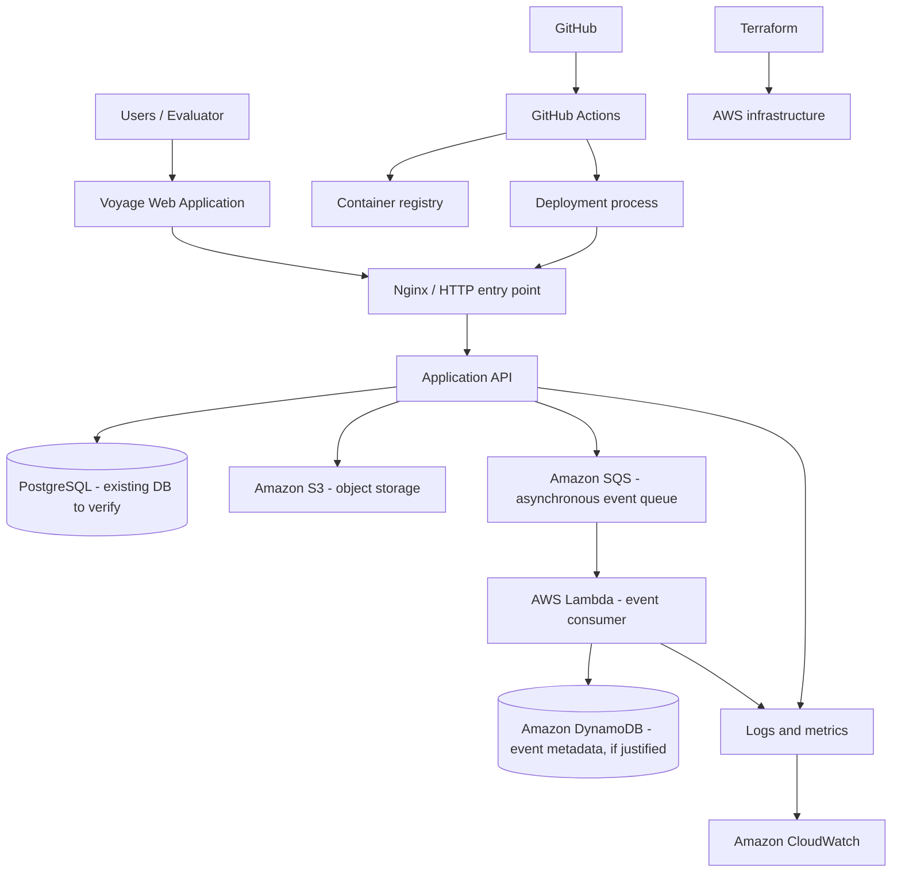

# Architecture Overview (Proposed, not yet validated)

## Status
Draft. This diagram is a starting hypothesis, not a record of deployed resources. Update it after the EC2 and AWS account audit.

## Proposed logical architecture

## Important design constraints

- The current EC2 host is reported as `t2.micro` with 1 GiB RAM. Do not plan a full Kubernetes, Spark, database and ML stack on that host without measuring available resources.
- Existing Voyage deployment and data take priority. Audit and back up before changes.
- Keep compute-heavy Spark and model-training tasks local unless a free, suitable cloud allocation is confirmed.
- Choose services only after checking current account eligibility and estimated cost.
- Microservices are a target design in the assignment, not a claim about the existing Voyage codebase. First inspect whether the backend is modular or monolithic; split only the smallest demonstrable bounded capabilities.
- K3s, SQS, DynamoDB, Mendix and other proposed technologies remain candidates until feasibility, cost and assignment acceptance are verified.

## Decisions still open

1. Actual AWS region and account-plan/credit expiry.
2. Existing EC2 OS, disk, VPC, subnet, security groups and IAM role.
3. Voyage repository layout and deployment topology.
4. Which module integrations can run locally versus AWS.
5. Whether faculty accepts documented alternatives for paid services named in the brief.
