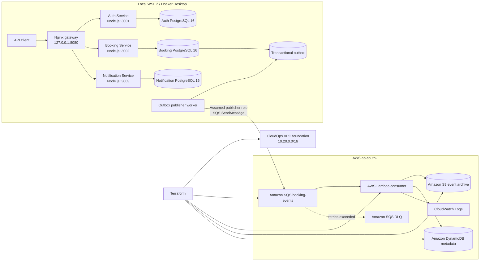

# Implemented Architecture Overview

**Status:** reflects the implementation and tests performed on 10 November 2026.

## Deployment boundary

The solution has two distinct environments:

1. **Local application environment:** WSL 2 / Docker Desktop runs the three Node.js services, three PostgreSQL containers, and Nginx gateway. The host gateway port is bound to `127.0.0.1:8080`.
2. **AWS environment (`ap-south-1`):** Terraform manages the CloudOps VPC foundation and the SQS, Lambda, S3, DynamoDB, IAM and CloudWatch event-processing resources.

The local Docker network is not connected to the AWS VPC. The outbox worker calls the AWS SQS API using short-lived STS credentials obtained by assuming a scoped publisher role. The existing Voyage EC2 workload is separate and was not changed.

## Logical architecture

## AWS network foundation

- VPC: `10.20.0.0/16`.
- Public subnets: `10.20.1.0/24` in `ap-south-1a`; `10.20.2.0/24` in `ap-south-1b`.
- Private subnets: `10.20.11.0/24` in `ap-south-1a`; `10.20.12.0/24` in `ap-south-1b`.
- Internet Gateway and public route table.
- Private route table contains only the local VPC route; no NAT Gateway is deployed.
- Edge, application and data security groups express tier-based access.
- Public subnets do not automatically assign public IPv4 addresses.

No compute or database service is deployed inside this VPC for the current build. This is a provisioned network foundation, not a claim that the local containers are running in AWS.

## Event-processing configuration

- SQS main queue and DLQ use SQS-managed encryption.
- Main queue visibility timeout: 180 seconds.
- Redrive maximum receive count: 5.
- Lambda runtime: Python 3.14; memory: 128 MB; timeout: 20 seconds.
- Event-source mapping: batch size 5, maximum batching window 5 seconds, partial batch failure reporting enabled, maximum concurrency 2.
- DynamoDB: `PAY_PER_REQUEST`, partition key `event_id`, TTL attribute `expires_at`.
- S3: public access blocked, default SSE-S3 AES-256, lifecycle expiration after 30 days for `booking-events/`.
- CloudWatch log retention: 7 days.

## Operational boundaries

- API/database containers are for local development and demonstration.
- CI builds and validates; it does not deploy the application.
- The publisher IAM role is assumed by the configured Terraform CLI principal for the local demonstration. A deployed worker should use an attached workload role instead.
- No Big Data/ML pipeline or no-code app was implemented.
